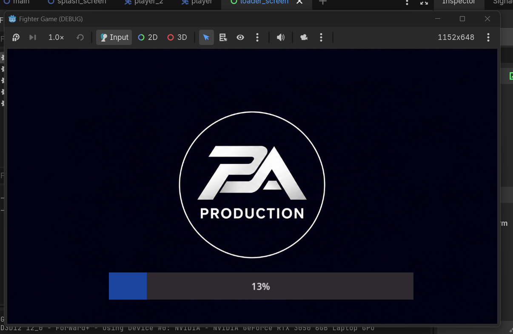

# Fighter Game

A small 2D fighting game prototype built with Godot 4.7. This project is a simple arena-based combat game where two fighters battle using movement, jumping, and attacks.

## Overview

This project was created as a learning-focused Godot game prototype and includes a basic fighting setup with:

- side-view arena gameplay
- local two-player combat
- health bars and attack damage
- simple sprite-based character movement

## How to run

1. Open the project folder in Godot 4.7+
2. Import the project.godot file
3. Press F5 or choose Run to launch the main scene

## Controls

Player 1:
- A / D: move
- J / Space: jump
- F: attack

Player 2:
- Left / Right arrow keys: move
- use the configured input map for jump and attack in the project settings

## Screenshots

## Project structure

- `Scenes/` — gameplay scenes and player scripts
- `Assets/` — visual assets used by the game
- `project.godot` — Godot project configuration

## Notes

This is a lightweight prototype and can be expanded with animations, sound effects, combo systems, more fighters, or a menu screen.
